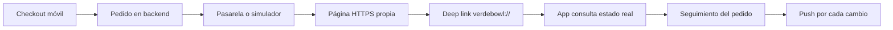

# App móvil — Fase 4

## Resultado

La fase 4 convierte el flujo de compra anterior en una experiencia operativa
después de pagar: el cliente puede seguir, retomar, cancelar o repetir su pedido;
recibe avisos de estado y puede precisar la entrega usando GPS y mapa.

## Flujo implementado



La página de retorno no confirma pagos por sí sola. Solo abre la app con el número
del pedido; la app exige la sesión del usuario y consulta nuevamente el backend.
La confirmación continúa dependiendo del webhook firmado de la pasarela.

## Funcionalidades

### Seguimiento y posventa

- El historial de pedidos abre un detalle completo.
- Se muestran estado actual, línea de tiempo, local, modalidad, dirección, productos,
  personalizaciones, notas, subtotal, descuentos, delivery, IGV y total.
- Los pedidos pendientes permiten retomar el pago.
- La cancelación solo aparece en estados permitidos por el backend.
- “Pedir nuevamente” reconstruye el carrito con productos que todavía existen y
  avisa cuando alguno dejó de estar publicado.

### Retorno de pagos

- El checkout móvil envía el canal controlado `MOBILE`, no una URL arbitraria.
- El backend construye el retorno con `MOBILE_RETURN_BASE_URL` o `FRONTEND_URL`.
- La ruta web `/checkout/movil` abre `verdebowl://checkout/result`.
- Al regresar, la app sondea el pedido real; no confía en `resultado=aprobado`.
- El simulador local utiliza el mismo origen que el retorno, por lo que puede abrirse
  desde un teléfono en la red local.

### GPS y dirección exacta

- Solicitud explícita del permiso de ubicación en primer uso.
- Geocodificación inversa a través del backend.
- Homologación con departamento, provincia y distrito del UBIGEO del sistema.
- Mapa con pin arrastrable y selección por toque.
- Nueva comprobación de cobertura al mover el punto.
- La jerarquía anterior se limpia antes de aplicar un pin nuevo para impedir que se
  guarde un distrito antiguo con coordenadas diferentes.

### Notificaciones de pedidos

- Registro autenticado de tokens Expo por dispositivo.
- Un token que inicia sesión con otra cuenta se reasigna de forma controlada.
- Al cerrar sesión el dispositivo se desactiva en el backend.
- El envío es idempotente por pedido, estado y dispositivo.
- Los tokens reportados como `DeviceNotRegistered` se desactivan.
- Tocar el aviso abre directamente el pedido correspondiente.
- Un fallo del proveedor push no revierte ni bloquea el cambio del pedido.

## Datos y API

La migración `0019-dispositivos-push-clientes.ts` crea `mobile_devices` con usuario,
token único, plataforma, identificador de dispositivo, versión, actividad y fechas
de última presencia/entrega.

Endpoints autenticados nuevos:

- `POST /api/v1/account/mobile-devices`
- `DELETE /api/v1/account/mobile-devices`

También se reutilizan los endpoints existentes de pedidos, cancelación, catálogo,
cobertura y geocodificación inversa. Las reglas sensibles siguen en el backend.

## Configuración local

En `mobile/.env`:

```env
EXPO_PUBLIC_API_URL=http://TU_IP:4000/api/v1
EXPO_PUBLIC_WEB_URL=http://TU_IP:5173
EXPO_PUBLIC_EAS_PROJECT_ID=ID_ASIGNADO_POR_EAS
```

En `backend/.env`, para que el navegador del teléfono pueda completar el retorno:

```env
MOBILE_RETURN_BASE_URL=http://TU_IP:5173
```

Backend, frontend y teléfono deben alcanzar esas direcciones. En producción ambas
deben reemplazarse por dominios HTTPS públicos.

Aplica la migración antes de habilitar push:

```powershell
npm run db:migrate --workspace backend
```

## Development build Android

El proyecto incorpora `expo-dev-client`, permisos nativos y `eas.json` con perfiles
`development`, `preview` y `production`.

```powershell
cd mobile
npx eas-cli@latest login
npx eas-cli@latest init
npx eas-cli@latest build --platform android --profile development
```

Instala el APK del enlace de EAS y ejecuta:

```powershell
npm run start:dev-client
```

Para un APK interno que no dependa de Metro:

```powershell
npx eas-cli@latest build --platform android --profile preview
```

## Verificación realizada

- TypeScript backend: correcto.
- TypeScript frontend: correcto.
- TypeScript móvil: correcto.
- Suite backend: 55 pruebas aprobadas, 0 fallos.
- Build backend y migración `0019` copiada a `dist`: correcto.
- Migraciones `0012` a `0019` aplicadas en la base local; 0 pendientes.
- Build web: correcto.
- Export Android: bundle y recursos generados correctamente.
- Configuración Expo pública: SDK 57, versión 0.4.0, esquema, ubicación y plugins
  de notificaciones validados.

La creación del APK firmado en la nube requiere que el propietario inicie sesión en
su cuenta Expo y ejecute `eas init`; el identificador del proyecto no debe inventarse
ni compartirse entre aplicaciones distintas.
